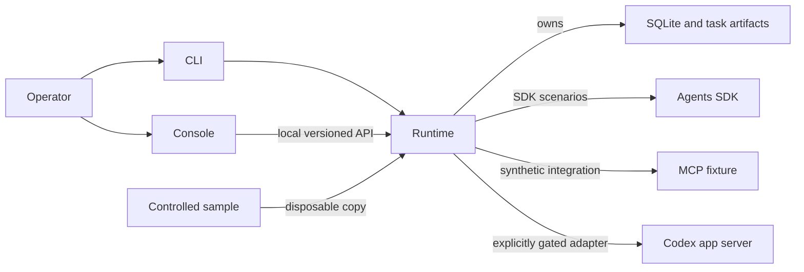

# Architecture

The runtime owns task definitions, lifecycle, scenario registry, CLI, a standard-library HTTP API, persistence and observation. The static console calls the API; it does not open the database. The MCP fixture provides synthetic protocol tools. The sample is a deliberately defective target, copied for experiments so the canonical checkout remains intact. The umbrella holds contracts, scripts and component pins; it is not another agent executor. Components remain independently testable and do not import each other's private source trees.

Application TaskRun records are distinct from SDK conversational sessions and SDK RunState. Local observations correlate task or scenario identifiers with events and traces where available; missing counts and costs must remain unavailable rather than guessed. SDK tracing and application instrumentation are distinct. The local API exposes bounded actions, not a general-purpose remote code execution endpoint.

The inspected manifest uses Git submodules and records revisions, but the runtime and console checkouts were ahead of its recorded revisions. A submodule pin identifies a particular commit, not all work in a checkout. The existence of a GitHub remote does not show that newer local changes are published.
